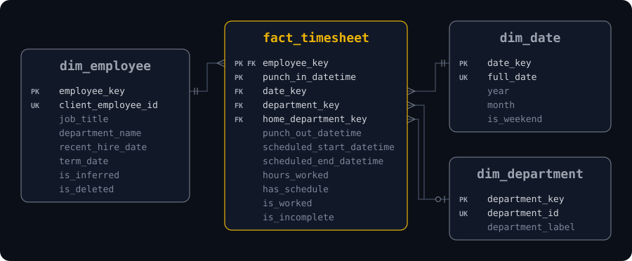

# HR Workforce Pipeline

An end-to-end ELT pipeline for hospital workforce data. Raw employee and timesheet extracts land in MinIO, are loaded and cleaned through bronze, silver, and gold layers in PostgreSQL under Airflow orchestration, and are served through a FastAPI service and a Streamlit dashboard. Everything runs in Docker.

## Quick start

**Needs:** Docker Desktop. Ports 5433, 8000, 8080, 8501, 9000 and 9001 must
be free.

    git clone https://github.com/sworaj42/hr-workforce-analytics-pipeline.git
    cd hr-workforce-analytics-pipeline
    cp .env.example .env
    docker compose up -d

**Run the pipeline:** in Airflow, trigger `hr_pipeline` (or
`docker compose exec airflow-scheduler airflow dags trigger hr_pipeline`).
A run takes under a minute; then refresh the dashboard.

| Service | URL | Login (from `.env`) |
|---|---|---|
| Airflow | http://localhost:8080 | `AIRFLOW_ADMIN_USER` / `AIRFLOW_ADMIN_PASSWORD` |
| API docs | http://localhost:8000/docs | `admin` or `viewer` / `API_ADMIN_PASSWORD`, `API_VIEWER_PASSWORD` |
| Dashboard | http://localhost:8501 | none |
| MinIO console | http://localhost:9001 | `MINIO_ROOT_USER` / `MINIO_ROOT_PASSWORD` |

Configuration, options and troubleshooting: [docs/setup.md](docs/setup.md)

## Tech stack

| Part | Tool |
|---|---|
| Landing zone | MinIO (S3-compatible) |
| Warehouse | PostgreSQL 16 |
| Orchestration | Apache Airflow 3.x (LocalExecutor) |
| Transformations | SQL inside Postgres, run from Python (`psycopg2`) |
| Migrations | Numbered SQL files, applied automatically on start |
| API | FastAPI, JWT login (PyJWT, bcrypt) |
| Dashboard | Streamlit, Plotly, pandas |
| Tests | pytest |
| Runtime | Docker Compose |

## Medallion layers

One PostgreSQL database with a schema per layer. Bronze keeps the files as
they arrived, silver makes them correct, gold makes them easy to analyse.

### Bronze: raw data, as delivered

| Table | Purpose |
|---|---|
| `bronze.employee_raw` | Every row of the employee file, all columns as `TEXT` |
| `bronze.timesheet_raw` | Every row of the timesheet files, all columns as `TEXT` |

Each row also records its `source_file`, `source_row_num` and `loaded_at`.

**Source → bronze**
- Files are read from MinIO (or the local `data/` folder) and copied in
  as-is with `COPY`.
- Each file's header is checked against the table, so a changed layout fails
  instead of loading shifted columns.
- A rerun replaces a file's rows instead of duplicating them.

### Silver: clean, typed, deduplicated

| Table | Purpose |
|---|---|
| `silver.employee` | One row per employee, typed; masked and personal fields dropped |
| `silver.timesheet` | One row per employee per punch-in, typed and deduplicated |
| `silver.employee_rejects` | Employee rows that failed validation, with the reason |
| `silver.timesheet_rejects` | Timesheet rows that failed validation, with the reason |
| `silver.cleaning_log` | Row counts per build: read, rejected, duplicate, loaded |

**Bronze → silver**
- **Clean:** trim spaces, turn empty strings and `[NULL]` into real NULLs.
- **Validate:** rows that break a rule go to the rejects table with their
  original values and the reason.
- **Type:** cast to timestamps, dates, numbers and booleans.
- **Deduplicate:** the extracts overlap, so the same punch appears in two
  files; the latest extract wins (412,571 rows → 381,732).
- **Derive:** flags such as `has_schedule`, `is_incomplete` and `is_per_diem`.

### Gold: star schema for analysis

| Table | Purpose |
|---|---|
| `gold.fact_timesheet` | One row per punch: keys to the dimensions, times, hours, flags |
| `gold.dim_employee` | One row per employee, including inferred employees |
| `gold.dim_department` | One row per department ID, with a readable label |
| `gold.dim_date` | One row per calendar day |
| `gold.kpi_*` views | The KPIs, computed from the tables above when queried |

**Silver → gold**
- **Dimensions** are upserted, keeping stable surrogate keys.
- **Inferred employees:** the timesheets name 10,773 employees, but the
  employee file has only 50; each missing one gets a placeholder row
  (`is_inferred = true`), so every punch links to an employee.
- **Fact:** each punch gets its dimension keys and an `is_worked` flag
  (time-off bookings aren't worked time).
- **KPI views** are plain SQL views, always in step with the tables.

## Docs

- [Setup](docs/setup.md)
- [Schema](docs/schema.md)
- [Assumptions](docs/assumptions.md)
- [KPIs](docs/kpis.md)
- [Data quality](docs/quality.md) · [sample report](docs/sample_report.md)
- [API](docs/api.md)
- [Indexing](docs/indexing.md)
